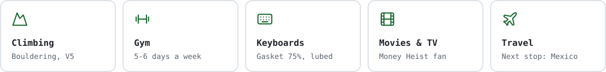

<picture>
  <source media="(prefers-color-scheme: dark)" srcset="./assets/card-dark.svg">
  
</picture>

<p align="center">
  <picture>
    <source media="(prefers-color-scheme: dark)" srcset="https://readme-typing-svg.demolab.com/?font=JetBrains+Mono&size=18&duration=3200&pause=2600&center=true&vCenter=true&width=640&height=40&lines=Coding+since+2017;Full+stack%2C+from+schema+to+pixels;Wrote+an+AI+model+runner+from+scratch+in+Rust;Built+a+sync+engine+8.4x+faster+than+Yjs;Making+slow+things+fast;Finding+the+bug+everyone+gave+up+on;Oregon+State+CS%2C+Honors;Top+finish+at+the+BOLT2+hackathon;Rock+climber+and+gym+regular;Probably+lubing+switches+right+now;Every+keyboard+is+my+endgame+keyboard;Breaking+Bad+is+the+best+show+ever+made;Always+planning+the+next+trip&color=7EE787">
    
  </picture>
</p>

I'm Maddox, a software engineer in Beaverton, Oregon. I like owning things end to end, from the database schema to the last pixel, and I'm happiest making slow things fast and flaky things boring.

**New here?** Start with [Kiln](https://github.com/MaddoxNehls/kiln) or [Tandem](https://github.com/MaddoxNehls/tandem) below, or see everything at [maddoxnehls.vercel.app](https://maddoxnehls.vercel.app).

<p align="center">
  <picture>
    <source media="(prefers-color-scheme: dark)" srcset="https://skillicons.dev/icons?i=ts%2Creact%2Cnextjs%2Cvue%2Ctailwind%2Cnodejs%2Cpython%2Cgo%2Crust%2Cjava%2Cphp%2Claravel%2Cpostgres%2Cmongodb%2Cdocker%2Cvercel&perline=16">
    
  </picture>
</p>

### How I work

<picture>
  <source media="(prefers-color-scheme: dark)" srcset="./assets/tiles-dark.svg">
  
</picture>

<details>
<summary><b>⌨️ Keyboard corner</b></summary>

```text
Board ........ custom 75%, gasket mount, hot-swap PCB
Case ......... CNC aluminum, e-white, brass weight
Plate ........ polycarbonate with flex cuts
Switches ..... Gateron Oil King linears, hand-lubed (Krytox 205g0), filmed
Springs ...... 62g long pole, bag-lubed
Stabilizers .. Durock V2, clipped, band-aid modded, dielectric grease
Keycaps ...... GMK Olivia++, Cherry profile
Mods ......... tape mod, PE foam, force-break
Firmware ..... QMK, with a layer for IDE shortcuts
Sound ........ deep, muted thock
Next build ... a split ergo for my wrists
```

</details>

<details>
<summary><b>✈️ Places I've been</b></summary>
<br>

 Canada &nbsp;·&nbsp;  Japan &nbsp;·&nbsp;  Italy &nbsp;·&nbsp;  France &nbsp;·&nbsp;  United Kingdom &nbsp;·&nbsp;  Costa Rica

**Next stop:**  Mexico

</details>

<details>
<summary><b>🎬 Watchlist</b></summary>
<br>

| Watching now | All-time favorites |
| --- | --- |
| Lucy | Money Heist |
| The 100 | Breaking Bad |
| | Silo |

<!-- letterboxd:start -->
<!-- letterboxd:end -->

</details>

<br>

<picture>
  <source media="(prefers-color-scheme: dark)" srcset="./assets/signoff-dark.svg">
  
</picture>
